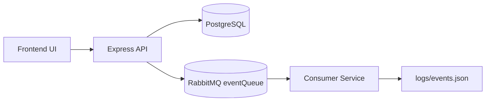
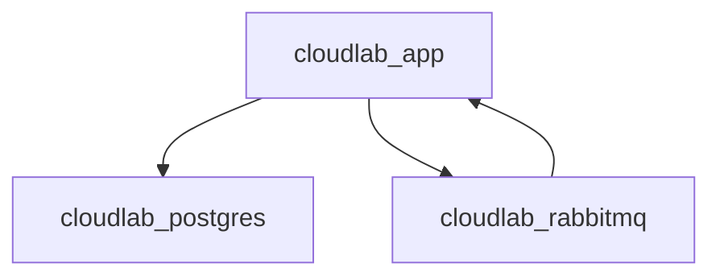

# u2022039 CloudLab Platform

     

Cloud-native university project upgraded for A-grade final submission, viva demo, and portfolio presentation.

## Features
- JWT-based authentication with bcrypt password hashing
- Event creation and retrieval APIs
- Async event publishing to RabbitMQ queue (`eventQueue`)
- Background consumer with JSON event log (`logs/events.json`)
- Live system monitor page (`/monitor.html`)
- Professional frontend dashboard (responsive + animated)
- Docker Compose stack with healthchecks and restart policies
- AWS deployment support (ECR + ECS templates)

## Architecture Diagram


## Docker Architecture


## Project Structure
```text
u2022039_cloudlab/
├── config/              # DB and RabbitMQ config
├── controllers/         # API business logic
├── middleware/          # auth, logging, validation, async wrapper
├── routes/              # auth/events/status routes
├── services/            # publisher + consumer
├── public/              # frontend pages and assets
├── logs/                # consumed event logs
├── aws/                 # ECR/ECS deployment files
├── submission/          # final report material
├── docker-compose.yml
├── Dockerfile
├── server.js
└── README.md
```

## API Documentation (Quick)
- `GET /` -> Landing page
- `GET /status` -> Backend/DB/RabbitMQ status
- `POST /register` -> Register user
- `POST /login` -> Login user and return JWT
- `POST /events` -> Create event and publish queue message (JWT required)
- `GET /events` -> List all events

## Run Locally (Windows + Cursor + Docker Desktop)
```bash
docker compose up --build
```

Open:
- Frontend: [http://localhost:5000](http://localhost:5000)
- RabbitMQ dashboard: [http://localhost:15672](http://localhost:15672) (`guest` / `guest`)

## Screenshots Section
Add final screenshots to `submission/screenshots/`:
- Project structure
- Running containers
- Dashboard
- API monitor
- Register/login success
- Event creation and list
- RabbitMQ dashboard
- `logs/events.json`

## AWS Deployment
- ECR push script: `aws/deploy-ecr.ps1`
- ECS task template: `aws/ecs-task-definition-template.json`
- ECS commands: `aws/deploy-ecs-commands.md`

## Viva Highlights
- Why RabbitMQ? Decouples API writes from async event processing
- Why JWT? Stateless auth for scalable microservice-style APIs
- Why Docker Compose? Deterministic local cloud-like environment
- Why `/status`? Operational visibility and health diagnostics

## Troubleshooting
- If app starts before dependencies, retries in `server.js` handle it.
- If PowerShell blocks npm scripts, use Docker flow instead.
- If RabbitMQ dashboard not opening, ensure container is healthy and port `15672` is free.
