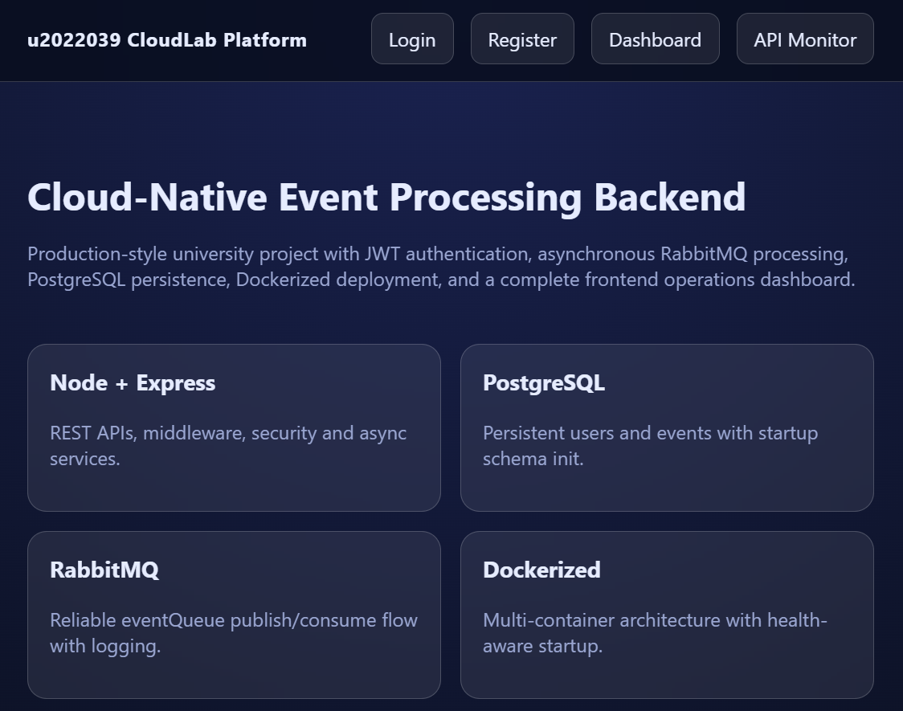
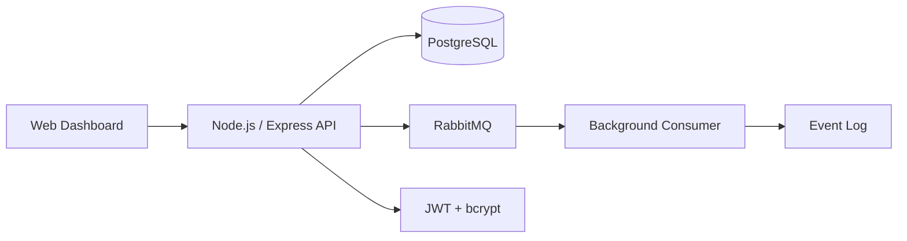
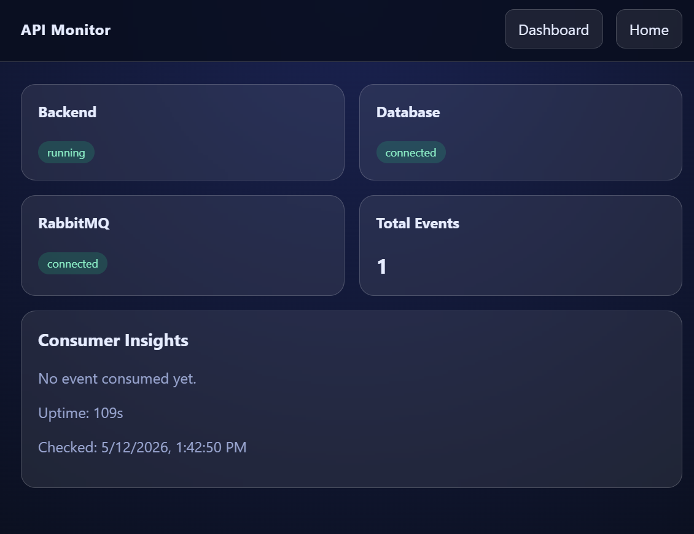
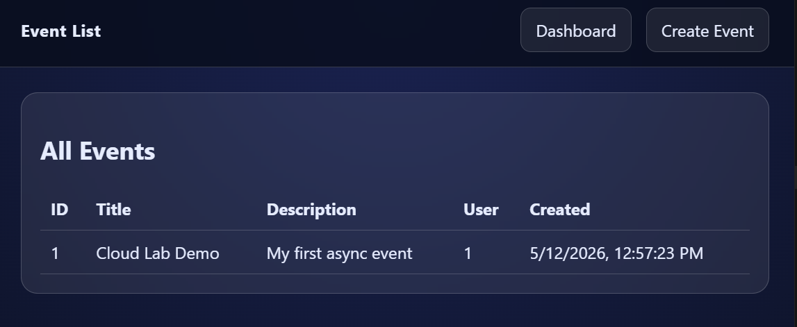
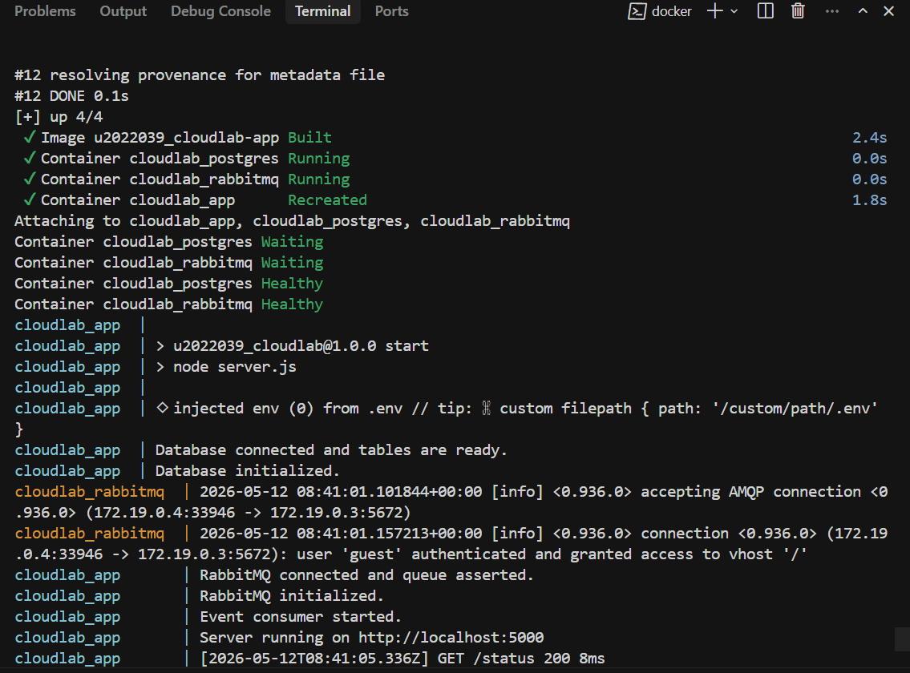
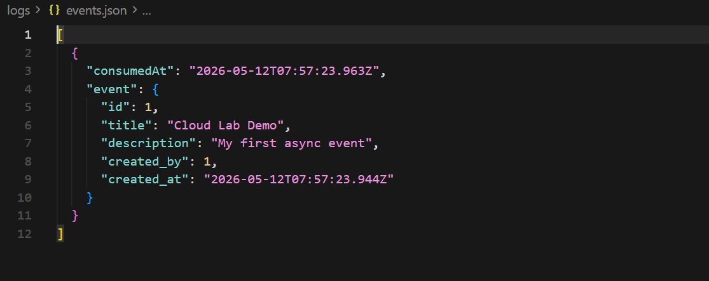

# CloudLab Platform

**Cloud-oriented event-driven backend platform with authentication, asynchronous messaging, and containerized deployment.**

CloudLab is a full-stack backend project built around a Node.js/Express API, PostgreSQL persistence, RabbitMQ messaging, JWT authentication, and Docker Compose. It demonstrates how an application can separate synchronous API requests from asynchronous event processing while retaining operational visibility.



## Highlights

- JWT authentication with bcrypt password hashing
- REST APIs for user authentication and event management
- Asynchronous event publishing through RabbitMQ
- Background event consumer with structured JSON logging
- Health/status endpoint for backend, database, and message-broker visibility
- Responsive browser dashboard
- Docker Compose environment with health checks and restart policies
- AWS-oriented ECR/ECS deployment templates

## Architecture



## Screenshots

| API monitor | Event list |
|---|---|
|  |  |

| Docker Compose startup | Consumed event log |
|---|---|
|  |  |

More in [`docs/screenshots/`](docs/screenshots/).

## Why RabbitMQ?

Event creation does not need to perform every downstream operation synchronously. The API publishes an event to RabbitMQ, allowing the consumer to process it independently. This creates an asynchronous boundary and demonstrates a pattern used in larger distributed systems.

## API Surface

| Endpoint | Purpose |
|---|---|
| `GET /` | Serve the application landing page |
| `GET /status` | Report backend/database/RabbitMQ status |
| `POST /register` | Create a user account |
| `POST /login` | Authenticate and return a JWT |
| `POST /events` | Create an event and publish a queue message |
| `GET /events` | Retrieve events |

## Technology Stack

**Backend:** Node.js, Express  
**Database:** PostgreSQL 16  
**Messaging:** RabbitMQ  
**Authentication:** JWT, bcrypt  
**Infrastructure:** Docker, Docker Compose  
**Cloud:** AWS ECR/ECS deployment templates  
**Frontend:** HTML/CSS/JavaScript dashboard

## Project Structure

```text
.
├── config/              # PostgreSQL and RabbitMQ configuration
├── controllers/         # API business logic
├── middleware/          # Authentication, logging, validation
├── routes/              # API route definitions
├── services/            # Publisher and consumer services
├── public/              # Frontend pages and assets
├── logs/                # Consumed event logs
├── aws/                 # ECR/ECS deployment material
├── docs/screenshots/    # Application screenshots
├── docker-compose.yml
├── Dockerfile
├── server.js
└── README.md
```

## Run Locally

```bash
cp .env.example .env
docker compose up --build
```

Then open `http://localhost:5000`.

## Operational Design

The server initializes PostgreSQL and RabbitMQ with retry handling to tolerate dependency startup races in a containerized environment. A status endpoint provides basic operational diagnostics, while the asynchronous consumer keeps event processing separate from the request path.

## AWS Deployment

The `aws/` directory contains material for an AWS deployment using Amazon ECR and ECS. These files are retained as deployment examples rather than representing a live hosted service.

## Project Context

Originally developed as a university cloud-computing project and extended into a portfolio demonstration of backend architecture, asynchronous messaging, authentication, containerization, and cloud deployment concepts.

## License

MIT. See [LICENSE](LICENSE).
